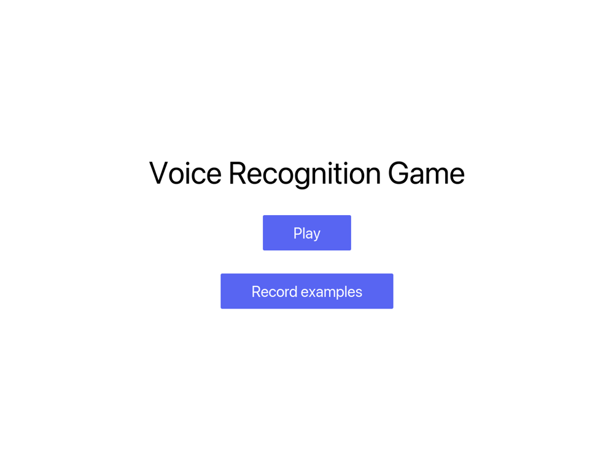
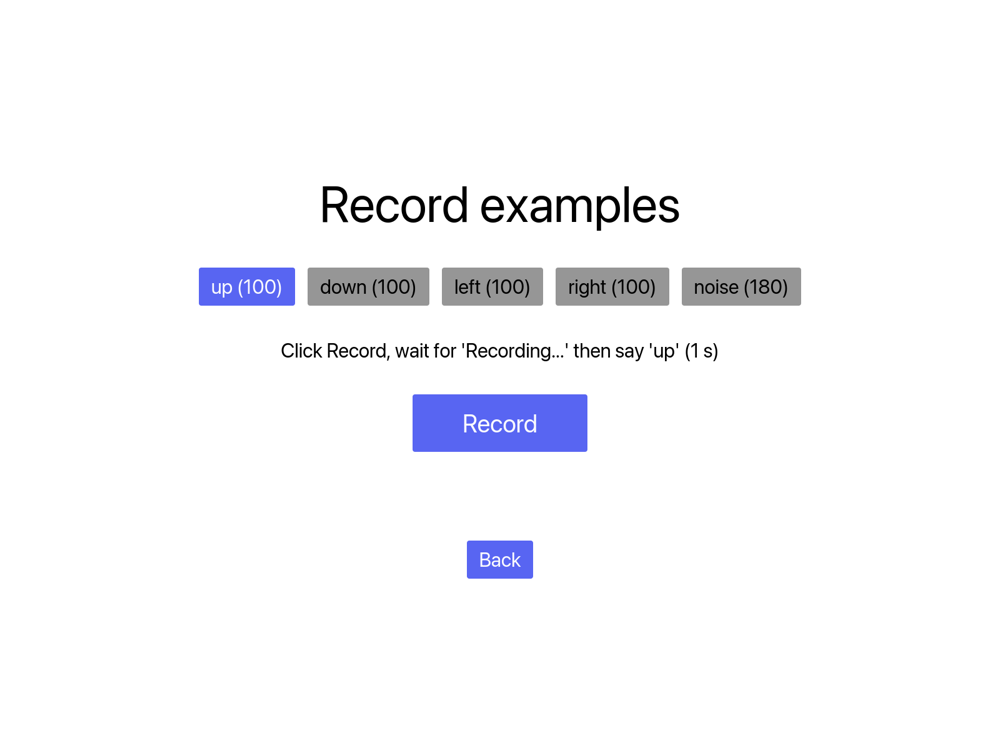
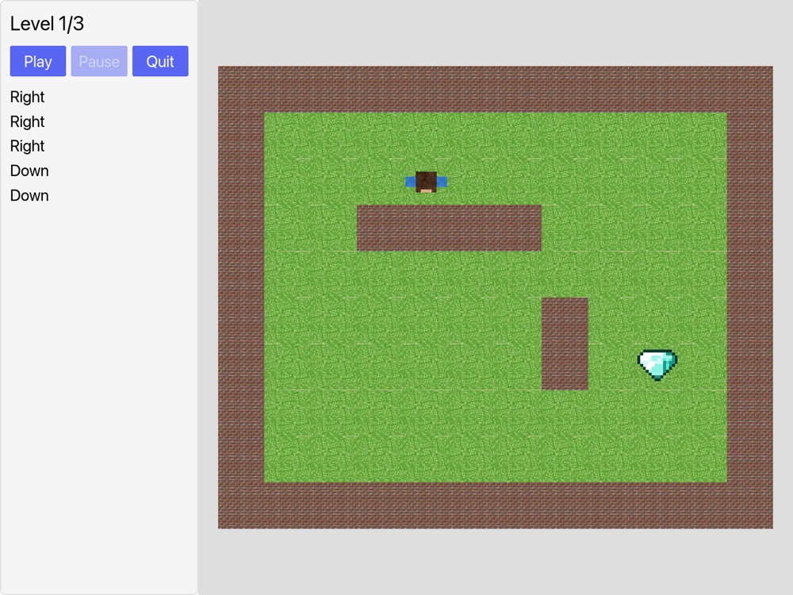

# 🎙️ Voice Recognition Game

A small game you play **with your voice**. Say `up`, `down`, `left` or `right` and a Minecraft-style character walks through a maze to reach the diamond. Three levels, no keyboard.

The speech recognition is not a library: it is a small neural network, written with [Burn](https://burn.dev), that you train yourself on your own voice, from inside the app.

```
 microphone ──▶ 1 s window ──▶ log-mel spectrogram ──▶ CNN ──▶ up / down / left / right ──▶ the character moves
```

## ✨ Features

- **Voice control** with a model trained on *your* voice, running locally
- **Recording page** in the app to build your dataset in a few clicks
- **Automatic training**: 80 % / 20 % split, validation accuracy, and a new attempt if the result is not good enough
- **3 levels** to walk through, the diamond leads to the next one
- **Minecraft textures** for the map and the character (top view built from a skin)
- Built with [iced](https://iced.rs) (GUI), [cpal](https://github.com/RustAudio/cpal) (microphone) and [Burn](https://burn.dev) (model)

## 📸 Screenshots

| Menu | Record page | Game |
|:---:|:---:|:---:|
|  |  |  |

## 📋 Requirements

- A recent Rust toolchain (the project uses the 2024 edition)
- A microphone (on macOS, allow it for your terminal the first time)
- A GPU supported by `wgpu` for the training (Metal, Vulkan, DX12). The game itself only runs the model on the CPU

## 🚀 Quick start

```sh
touch .env          # the program refuses to start without this file, it can stay empty
cargo run           # opens the app
```

1. **Record your voice**: in the menu, click **Record examples**. Pick a label, click **Record**, wait for `Recording...` and say the word. Each click saves 1 second in `data/<label>/`.
2. **Train the model** (close the app first):
   ```sh
   cargo run -- --train
   ```
   The weights are saved in `artifacts/model.mpk`.
3. **Play**: `cargo run`, then **Play**. Speak, the character follows.

### How many examples?

| Label | Examples |
|---|---|
| `up`, `down`, `left`, `right` | about **100** each (60 at the very least) |
| `noise` | **150 to 200**: silence, room noise, typing, other words and sentences |

Vary the volume, the speed and the distance to the microphone, and keep a similar number of examples for each word. The `noise` class is what stops the character from moving on its own.

## 🎮 The game

| Voice | Action |
|---|---|
| `up` / `down` / `left` / `right` | Turn the character and walk one tile |

Walls block the way. Taking the 💎 starts the next level, and after level 3 the game starts again at level 1. The levels are plain text maps in `src/app/game/map/mod.rs`:

```
#  wall      .  floor      P  start      D  diamond
```

## 🧠 Training

`cargo run -- --train` does the following:

1. reads the WAV files of `data/<label>/`
2. keeps 20 % of the recordings of each label, picked at random, to validate the model
3. trains on the other 80 % (30 epochs, with shifted copies of each sound to get more examples)
4. computes the accuracy on the validation set
5. if it is under **90 %**, starts again on a new split (up to **3 attempts**) and keeps the best weights

Logs and checkpoints of each attempt are in `artifacts/training/attempt-N/`.

## ⚙️ Configuration

Everything is optional and read from the environment (or from the `.env` file).

| Variable | Default | Role |
|---|---|---|
| `DATA_DIR` | `data` | Recorded examples, one sub folder per label |
| `WEIGHTS_PATH` | `artifacts/model.mpk` | Trained weights read by the game |
| `TEXTURES_DIR` | `assets/textures` | Textures of the map and of the character |

Command line:

```
cargo run -- [-v | --verbose] [--train]
```

`-v` prints debug logs, including every recognized command.

## 🖼️ Textures

The game reads PNG files from `assets/textures/`, see [the list there](assets/textures/README.md):

| File | Used for |
|---|---|
| `moss_block.png` | floor |
| `cobblestone.png` | walls |
| `diamond_ore.png` | the diamond |
| `player.png` | the character: a 64x64 Minecraft skin, seen from above |

A missing file is replaced by a plain color, and a missing skin by a character drawn with shapes, so the game always runs. The Minecraft textures belong to Mojang, they are not meant to be published with this repository: copy them from your own copy of the game (`assets/minecraft/textures/` inside the `.jar`).

## 🗂️ Project layout

```
.
├── crates
│   ├── voice_audio      microphone capture: mono, resampled to 16 kHz
│   └── voice_model      spectrogram, CNN, inference and training glue (Burn)
├── src
│   ├── app              iced app: menu, game, record page, textures
│   │   └── game         game logic: map, levels, player
│   ├── train            recording of examples and training (feature `train`)
│   └── voice            listening thread: microphone → model → commands
├── assets/textures      the PNG files (not versioned)
├── data                 your recordings (not versioned)
└── artifacts            trained weights and training logs (not versioned)
```

The `train` feature is enabled by default. Without it (`--no-default-features`) the game still runs but drops the training, the recording page and their dependencies.

## 🧪 Tests

```sh
cargo test
```

They check that every level can be finished and that the skin of the player is read correctly.

## ⚠️ Limitations

- The microphone is cut in 1 second windows without overlap, so a word said across two windows can be missed, and a command appears up to 1 second after it was said.
- The model only knows your voice and your microphone: retrain it with new examples if you change either.
